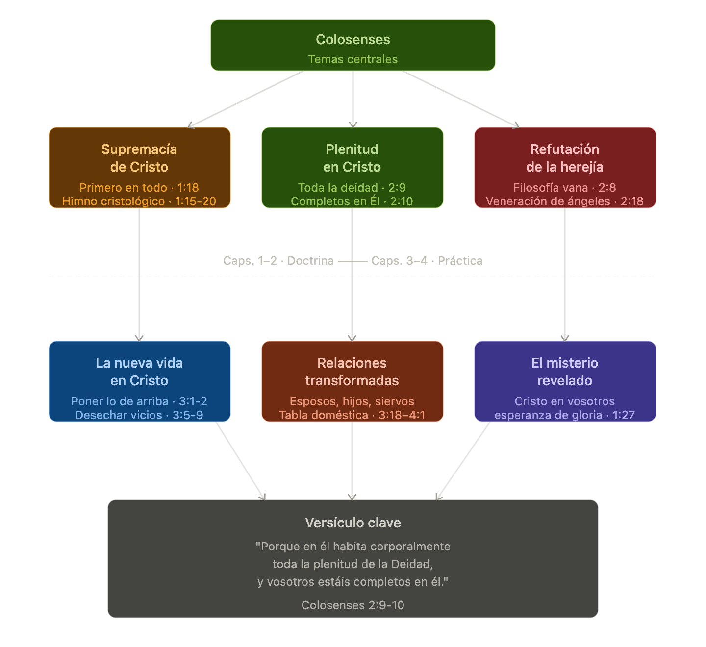

# La Carta a los Colosenses: Introducción General

<strong>Contexto histórico y geográfico</strong>

**Colosas** era una ciudad del interior de Asia Menor (la actual Turquía), ubicada en el valle del río Lico, en la región de Frigia, a unos 180 kilómetros al este de Éfeso.

<figure><figcaption></figcaption></figure>

En su época de mayor esplendor, durante el período persa y helenístico, había sido una ciudad próspera y populosa, famosa por su lana teñida de rojo oscuro, llamada precisamente _colossinus_. Sin embargo, para la época de Pablo era una ciudad de **segundo orden**, opacada por sus vecinas más importantes: **Laodicea** (a 18 km) y **Hierápolis** (a 21 km), ambas mencionadas en la carta.

<figure><figcaption></figcaption></figure>

El valle del Lico era una zona sísmicamente activa: alrededor del año 60-61 d.C., un terremoto devastador destruyó Laodicea y probablemente afectó también a Colosas, aunque las fuentes antiguas no son uniformes al respecto. Esto es relevante porque coincide aproximadamente con la fecha en que Pablo escribe la carta.

La sociedad colosense era un crisol cultural notable. Convivían allí tres grupos principales: **griegos** con su filosofía y cultura helenística, una importante **comunidad judía** de la diáspora con sus tradiciones y prácticas religiosas, y una población **frigia nativa** con sus propias creencias religiosas locales, conocidas por su misticismo y sus prácticas de culto extático. Esta mezcla cultural es el caldo de cultivo directo para la herejía que Pablo combate en la carta.

La región de Frigia tenía además una larga tradición de **sincretismo religioso**: la tendencia a mezclar elementos de distintas religiones en un sistema nuevo. Los frigios eran conocidos en el mundo antiguo por su inclinación a los cultos de misterio, las visiones, las prácticas ascéticas y la veneración de potencias espirituales intermedias. Todo esto resuena directamente en los errores que Pablo corrige.

<strong>Circunstancias de la carta</strong>

Un dato notable es que **Pablo nunca visitó Colosas personalmente**. La iglesia fue fundada, casi con certeza, por **Epafras**, un colosense convertido durante el ministerio de Pablo en Éfeso (54-57 d.C.), quien llevó el evangelio a su ciudad natal y a todo el valle del Lico. Pablo conoce a esta comunidad por los informes de Epafras, no por experiencia directa.

Pablo escribe Colosenses desde la **prisión**, casi con certeza en Roma, alrededor del **60-62 d.C.**, el mismo período de Efesios, Filipenses y Filemón. Las cuatro son conocidas como las "cartas de la prisión." Colosenses y Efesios comparten tanto vocabulario y estructura que muchos eruditos las llaman cartas gemelas: el mismo portador, **Tíquico**, lleva ambas en el mismo viaje, acompañado de **Onésimo** (el esclavo fugitivo del que trata Filemón).

La razón de la carta es una **crisis teológica concreta**: ha surgido en Colosas una enseñanza que Pablo llama "filosofía vana" (2:8), una especie de sistema sincretista que combina elementos judíos, griegos y místicos frigios. Esta enseñanza no reemplaza a Cristo directamente, sino que lo _suplementa_: dice que Cristo es insuficiente, que para una espiritualidad completa hacen falta también la observancia de días y comidas, la circuncisión, el ascetismo corporal, y sobre todo la **veneración de ángeles** o potencias espirituales intermedias como escalones necesarios para acercarse a Dios.

La respuesta de Pablo es radical y directa: **en Cristo habita toda la plenitud de la divinidad corporalmente** (2:9). No hay nada que añadir. Cualquier sistema que agregue requisitos a Cristo no lo complementa, sino que lo desplaza.

<strong>Temas centrales de la carta</strong>

<figure><figcaption></figcaption></figure>

**La supremacía de Cristo.** El corazón doctrinal de Colosenses es el himno cristológico de 1:15-20, uno de los textos más elevados del Nuevo Testamento. Cristo es "imagen del Dios invisible", "primogénito de toda creación", aquel por quien y para quien fueron creadas todas las cosas, incluidos los ángeles y potestades. Esta afirmación no es poesía decorativa: es una respuesta directa a quienes ponían a los ángeles como mediadores necesarios. Si Cristo creó a los ángeles, no tiene sentido rendirles culto para acercarse a Dios.

**Plenitud en Cristo.** El argumento central contra la herejía colosense es este: en Cristo habita _toda_ la plenitud de la deidad corporalmente (2:9), y el creyente está _completo_ en él (2:10). La palabra griega _pleroma_ ("plenitud") era probablemente un término técnico que los mismos maestros herejes usaban para describir las potencias espirituales superiores. Pablo lo toma y lo vacía: toda esa plenitud está en Cristo, y solo en Cristo.

**Refutación de la herejía.** Pablo describe el error en términos de sus prácticas concretas: regulaciones sobre alimentos y bebidas, observancia de lunas nuevas y sábados, ascetismo corporal ("no toques, no pruebes, no manejes", 2:21), y veneración de ángeles. Lo llama "sombra de lo que había de venir", siendo Cristo la realidad. Esta herejía es única en el corpus paulino y no encaja perfectamente en ninguna categoría conocida, lo que ha fascinado a los intérpretes durante siglos.

**La nueva vida en Cristo.** Los capítulos 3 y 4 son la traducción práctica de la doctrina. Si el creyente murió y resucitó con Cristo (3:1-3), debe "poner la mira en las cosas de arriba" y desechar una lista de vicios que pertenecen a la vida vieja. El cambio de vida no viene de reglas ascéticas sino de la unión con Cristo.

**Relaciones transformadas.** Como en Efesios, Pablo incluye una tabla doméstica (3:18–4:1): esposas, esposos, hijos, padres, siervos, amos. Pero con un énfasis particular: cada relación debe vivirse "como al Señor", porque Cristo es el Señor de todas las esferas de la vida, no solo de la "espiritualidad" privada.

**El misterio revelado.** Una de las palabras clave de la carta es _misterio_: ese secreto oculto por siglos que ahora Dios hace conocer. Y la definición que Pablo da es sorprendente en su intimidad: el misterio es "Cristo en vosotros, la esperanza de gloria" (1:27). No un sistema filosófico, no una jerarquía de ángeles: una persona habitando en el creyente.

<strong>Personajes involucrados</strong>

<figure><figcaption></figcaption></figure>

**Pablo** se identifica como autor en 1:1 y nuevamente en 4:18, donde toma la pluma para escribir el saludo de su propia mano. Escribe con autoridad pastoral sobre una iglesia que nunca visitó, porque la considera parte de su radio de responsabilidad apostólica dado que fue fundada durante su ministerio en Éfeso.

**Timoteo** aparece como coautor en el saludo inicial, como en varias otras cartas de la prisión. Su presencia le da continuidad y credibilidad a la comunicación con iglesias que lo conocían por sus viajes anteriores.

**Epafras** es el personaje clave de trasfondo. Colosense de nacimiento, convertido durante el ministerio de Pablo en Éfeso, volvió a su ciudad a fundar iglesias en todo el valle del Lico: Colosas, Laodicea e Hierápolis (4:13). Pablo lo elogia como "siervo fiel de Cristo" y dice que ora con fervor por los colosenses. Está con Pablo en Roma, posiblemente como su enviado para informar de la situación o incluso como preso (Flm. 23).

**Tíquico** es el mensajero de confianza que lleva la carta desde Roma a Colosas, en el mismo viaje en que entrega la carta a los Efesios. Pablo lo describe como "amado hermano, fiel ministro y consiervo en el Señor" (4:7) y lo envía específicamente para informar a los colosenses sobre su situación y consolarlos.

**Onésimo** es el esclavo fugitivo de Filemón, colosense, que se encontró con Pablo en Roma, se convirtió, y ahora regresa a Colosas acompañando a Tíquico. Pablo lo llama "fiel y amado hermano, que es uno de vosotros" (4:9). Su historia completa se cuenta en la breve carta a Filemón, enviada en el mismo paquete.

**Filemón** es mencionado indirectamente: dueño de Onésimo y anfitrión de una iglesia en su casa en Colosas. La carta a Filemón es, en cierto modo, el backstory humano de este personaje que aparece en el fondo de Colosenses.

**Arquipo** recibe un encargo personal al final: "Mira que cumplas el ministerio que recibiste en el Señor" (4:17). No se sabe exactamente cuál era su función, pero el tono sugiere que necesitaba un empujón de responsabilidad pastoral.

**Marcos** (el mismo Juan Marcos del libro de Hechos y del Evangelio) aparece como compañero de Pablo en Roma, con instrucciones de ser bien recibido si llega a Colosas. Esto es significativo: años antes Pablo y Bernabé habían tenido un conflicto serio por Marcos (Hch. 15:37-39). Su presencia aquí muestra una reconciliación completa.

**Lucas** aparece en un saludo brevísimo pero histórico: "Lucas el médico amado" (4:14), la única referencia explícita en toda la Biblia al autor del tercer Evangelio y de Hechos como médico.

**Ninfas** es una mujer de Laodicea en cuya casa se reúne una iglesia. Pablo manda saludarla y pide que la carta sea leída también en esa congregación, reforzando la idea de circulación entre iglesias del valle.

<strong>La herejía colosense</strong>

Vale la pena detenerse un momento en el error que Pablo combate, porque es inusual. No es el judaísmo puro (como en Gálatas), ni el libertinaje (como en Corinto), ni la confusión escatológica (como en Tesalónica). Es algo más complejo y difícil de clasificar, que mezcla al menos cuatro elementos:

**Elementos judíos:** circuncisión, observancia de días y meses, restricciones de alimentos y bebidas, normas del sábado.

**Elementos filosóficos griegos:** especulación sobre la naturaleza del cosmos, categorías de sabiduría y conocimiento superiores, lenguaje de "plenitud" (_pleroma_).

**Elementos místicos frigios:** visiones, experiencias espirituales de acceso a reinos celestiales, prácticas ascéticas del cuerpo.

**Veneración de ángeles o potencias:** la pieza más llamativa. Los ángeles eran vistos como mediadores necesarios entre los humanos y un Dios demasiado distante y puro para ser contactado directamente. Esta idea tiene raíces tanto en el judaísmo tardío como en las religiones de misterio orientales.

La respuesta de Pablo no es filosófica sino cristológica: no debate el sistema, sino que muestra que Cristo lo supera por completo y lo hace innecesario.

<strong>Una palabra sobre su lugar en el canon</strong>

La carta a los colosenses contiene una de las más sublimes descripciones de la persona y la obra de Cristo en el Nuevo Testamento, presentándolo como el Hijo de Dios, el Creador, el Sustentador, la Cabeza de la iglesia y el Señor de todo (Colosenses 1:15-20; 2:9-10; 3:1-4).

Colosenses ocupa un lugar único en las cartas de Pablo: es la respuesta más concentrada y elevada a la pregunta _¿quién es Cristo realmente?_ Mientras Gálatas defiende el evangelio de la gracia, y Efesios desarrolla la eclesiología, Colosenses se concentra en la **cristología**: Cristo como el principio y el fin de toda la creación, de toda la historia y de toda la vida del creyente.


