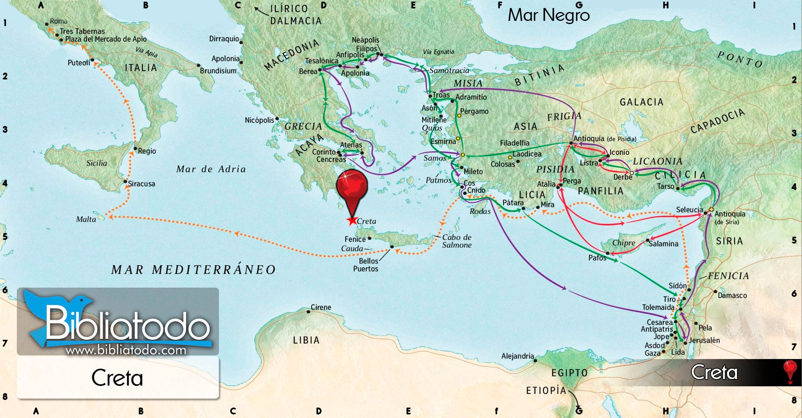

# La Carta a Tito: Introducción General

<strong>Naturaleza de la carta</strong>

Tito es la tercera de las **epístolas pastorales** (junto con 1 y 2 Timoteo) y está muy emparentada con 1ra Timoteo: ambas fueron escritas aproximadamente en la misma época, comparten vocabulario y estructura, y tienen el mismo propósito básico. Son cartas de un mentor veterano a un discípulo al que ha dejado a cargo de organizar y proteger iglesias jóvenes. Si 1ra Timoteo es el manual para Éfeso, **Tito es el manual para Creta**: más breve, más directo, pero con el mismo corazón pastoral.

<strong>Contexto histórico y geográfico</strong>

**Creta** es la isla más grande de Grecia y la quinta más grande del Mediterráneo, ubicada al sur del mar Egeo, marcando el límite entre el mundo griego y el norte de África. En la Antigüedad había sido la cuna de la **civilización minoica**, una de las culturas más antiguas y sofisticadas de Europa, pero para la época de Pablo era una provincia romana de reputación mixta: estratégicamente importante por su posición en las rutas marítimas, pero social y moralmente desprestigiada.

<figure><figcaption></figcaption></figure>

<figure><figcaption></figcaption></figure>

Los cretenses tenían **mala fama en todo el mundo antiguo**. Eran tan conocidos por su deshonestidad que los griegos acuñaron el verbo _krētízō_ ("cretizar"), que significaba directamente "mentir" o "engañar". Pablo mismo recoge esta reputación en la carta citando a un poeta cretense: "Los cretenses, siempre mentirosos, malas bestias, glotones ociosos" (1:12). La isla era conocida por una cultura de palabra poco confiable, hedonismo, pereza y codicia. Este trasfondo explica por qué Pablo insiste tanto en el **carácter íntegro** de los líderes y en las **buenas obras** como fruto visible de la fe: en una sociedad donde las palabras no valían nada, la conducta tenía que hablar.

Había también en Creta una comunidad **judía** considerable (de hecho, en Hechos 2:11 hay cretenses presentes en Pentecostés), y de ella surgieron los falsos maestros "de la circuncisión" que Pablo combate en la carta.

<strong>Circunstancias de la carta</strong>

Según la propia carta, Pablo había estado evangelizando en Creta junto a Tito, y al partir lo dejó allí para "corregir lo deficiente y establecer ancianos en cada ciudad" (1:5). Esto ubica la carta en el **período de libertad de Pablo tras su primer encarcelamiento romano**, alrededor del **63-64 d.C.**, el mismo marco temporal de 1ra Timoteo. (El libro de Hechos no narra este viaje a Creta, lo que confirma que ocurrió después de los eventos allí relatados.)

La iglesia cretense era **muy joven y desorganizada**. Faltaba estructura de liderazgo, circulaban enseñanzas falsas, y los nuevos creyentes venían de una cultura cuyos vicios había que desaprender. Pablo escribe para darle a Tito un encargo claro y urgente en tres frentes: **organizar** (nombrar ancianos idóneos), **enseñar** (la sana doctrina adaptada a cada grupo de la congregación) y **defender** (frente a los falsos maestros). La carta probablemente fue llevada por Zenas y Apolos (3:13).

<strong>Temas centrales de la carta</strong>

<figure><figcaption></figcaption></figure>

**Nombrar ancianos idóneos.** El primer encargo concreto de la carta. Tito debe "establecer ancianos en cada ciudad" (1:5), y Pablo le da la lista de cualidades requeridas, muy parecida a la de 1 Timoteo 3: irreprensible, marido de una sola mujer, con hijos creyentes, no soberbio, no iracundo, hospitalario, amante de lo bueno, retenedor de la sana doctrina. En una isla con fama de deshonestidad, el carácter del líder no era un detalle menor sino la primera línea de defensa.

**Refutar a los falsos maestros.** Pablo identifica a "muchos contumaces, habladores de vanidades y engañadores, mayormente los de la circuncisión" (1:10), es decir, maestros de trasfondo judío que promovían "fábulas judaicas" y mandamientos de hombres. Tito debe "taparles la boca" (1:11) y "reprenderlos duramente" (1:13), porque estaban trastornando casas enteras por ganancia deshonesta.

**Sana doctrina por grupos.** El capítulo 2 es una pequeña obra maestra de enseñanza pastoral adaptada. Pablo instruye a Tito sobre qué enseñar a cada grupo: a los ancianos (sobrios, serios, sanos en la fe), a las ancianas (reverentes, maestras de lo bueno), a las jóvenes (amar a sus maridos e hijos, ser prudentes), a los jóvenes (ser dominio propio), y a los siervos (ser fieles para "adornar la doctrina"). Cada grupo tiene su exhortación específica.

**La gracia que salva y enseña.** El corazón teológico de la carta está en 2:11-14, uno de los pasajes más hermosos sobre la gracia en todo el Nuevo Testamento. La gracia no solo salva: también _educa_. "Enseñándonos que, renunciando a la impiedad y a los deseos mundanos, vivamos en este siglo sobria, justa y piadosamente" (2:12). La gracia no es permiso para pecar, sino el poder que transforma la conducta.

**Salvación por misericordia.** En 3:4-7 Pablo resume el evangelio con una claridad cristalina: "Nos salvó, no por obras de justicia que nosotros hubiéramos hecho, sino por su misericordia" (3:5). Es un eco del mensaje central de Efesios y Gálatas, condensado en pocas líneas: la salvación es por pura gracia, mediante la regeneración del Espíritu Santo.

**Celo por las buenas obras.** Si hay una frase que distingue a Tito, es "buenas obras": aparece seis veces en tres capítulos cortos, más densamente que en cualquier otra carta. Pero el orden es clave y no se invierte: las buenas obras no _producen_ la salvación, sino que _brotan_ de ella. Cristo nos redimió para purificar "un pueblo propio, celoso de buenas obras" (2:14). En Creta, tierra de "glotones ociosos", esta insistencia en el bien activo era profundamente contracultural.

<strong>Personajes involucrados</strong>

<figure><figcaption></figcaption></figure>

**Pablo** es el autor, que escribe con autoridad apostólica pero también con afecto paternal. El saludo inicial (1:1-4) es inusualmente largo y teológico para una carta tan breve: Pablo condensa en él toda su comprensión del evangelio —elección, verdad, piedad, esperanza de vida eterna— antes de entrar en las instrucciones prácticas.

**Tito** es el destinatario, llamado "verdadero hijo en la común fe" (1:4). Era un cristiano **griego, no circuncidado**, convertido por Pablo, cuyo caso había sido una prueba viviente en el debate sobre la circuncisión (Gálatas 2:3: Pablo se negó a circuncidarlo como demostración de que los gentiles no necesitaban la ley). Era un colaborador de gran confianza y capacidad: Pablo lo había enviado antes a misiones difíciles, como mediar en el conflicto con la iglesia de Corinto (2 Corintios). Aquí tiene el encargo de ordenar la caótica situación cretense, lo que dice mucho de su firmeza y habilidad.

**Cristo** aparece en la carta con uno de los títulos más altos que Pablo le da en todo el Nuevo Testamento: "nuestro gran Dios y Salvador Jesucristo" (2:13), un texto clave para la doctrina de la deidad de Cristo. Es presentado como el que "se dio a sí mismo por nosotros para redimirnos" y formar un pueblo propio.

**Los ancianos** (también llamados obispos en 1:7) son los líderes que Tito debe nombrar en cada ciudad. No son personas concretas sino el oficio cuyo perfil Pablo detalla: hombres de carácter probado, buenos administradores de su casa, firmes en la sana doctrina y capaces de refutar a los que contradicen.

**Los de la circuncisión** son los falsos maestros, de trasfondo judío, que promovían fábulas y mandamientos humanos por ganancia deshonesta (1:10-11). Pablo es especialmente duro con ellos porque "trastornan casas enteras" y su enseñanza corrompía a la comunidad desde adentro.

**Epiménides** es un personaje curioso: un poeta y filósofo cretense del siglo VI a.C., a quien Pablo cita como "uno de ellos, su propio profeta" (1:12). La frase "los cretenses, siempre mentirosos, malas bestias, glotones ociosos" proviene de él. Es uno de los pocos lugares donde Pablo cita literatura pagana griega para respaldar su argumento, mostrando su conocimiento de la cultura de su audiencia.

**Artemas y Tíquico** son dos colaboradores de Pablo; el apóstol planea enviar a uno de ellos a Creta para **relevar a Tito** (3:12), señal de que la misión de Tito allí era temporal. Tíquico es el mismo mensajero fiel que aparece en Efesios y Colosenses.

**Zenas y Apolos** son probablemente los **portadores de la carta**. Zenas es llamado "intérprete de la ley" (posiblemente un abogado o un experto en la ley judía), y Apolos es el elocuente predicador de Alejandría que ya aparece en Hechos y en 1 Corintios. Pablo pide a Tito que los ayude en su viaje "para que nada les falte" (3:13).

<strong>Una palabra sobre su valor</strong>

Tito es breve —apenas tres capítulos— pero concentra el equilibrio perfecto que caracteriza al cristianismo maduro: **doctrina y vida, gracia y obras, creencia y conducta**. Pablo no deja que la fe se vuelva pura teoría ("los de la circuncisión" tenían doctrina pero vidas corruptas), ni permite que la conducta se vuelva legalismo (las buenas obras brotan de la gracia, no la compran). En una isla famosa por la hipocresía y la palabra vacía, el mensaje era demoledoramente claro: una fe verdadera se _nota_. Por eso Tito sigue siendo una de las cartas más útiles para pensar la relación entre lo que creemos y cómo vivimos.

